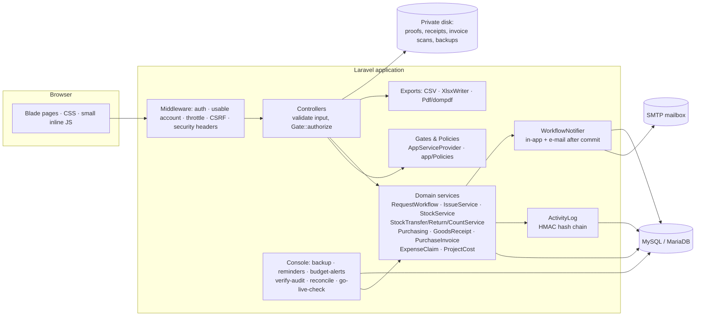
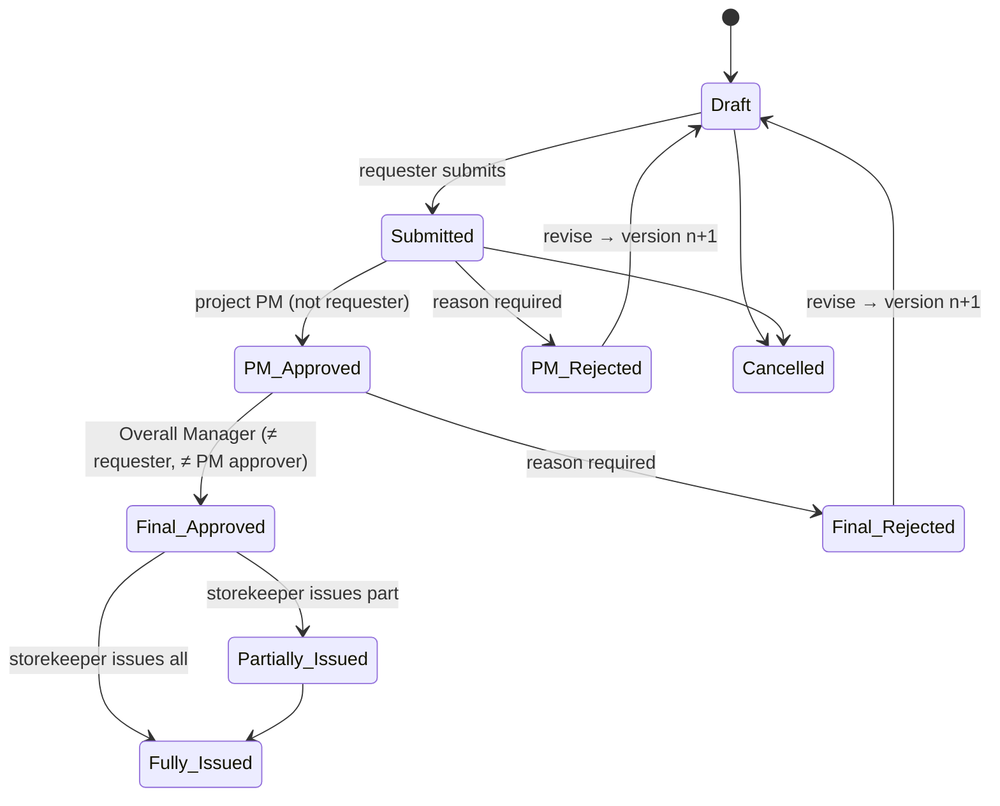

# Architecture

## Overview
A single Laravel 12 application (PHP ≥ 8.2) with server-rendered Blade pages and one hand-written CSS file, so it runs on ordinary shared hosting with no Node build step. MySQL 8 / MariaDB 10.4+ in production; SQLite in-memory for the automated tests.

### Rules of the road
- **Controllers** validate input and authorize; they never change stock or money directly.
- **Services** own every state change. Each runs in one database transaction, locks the rows it depends on in a fixed order (document → lines → items → balances, ascending ids), re-validates against the locked rows, writes the document, the ledger movement and the audit entry, and only then commits. Alerts are sent after commit.
- **Authorization twice**: a gate/policy at the route and the same rule (role, store assignment, separation of duties) inside the service.
- **Append-only records**: movements, vouchers, receipts, returns, approvals, invoice lines and payments refuse update/delete; corrections are new documents.
- **Idempotency**: posting forms carry a one-time key; repeats return the first document.

## Entity relationships (main tables)

```mermaid
erDiagram
    USERS ||--o{ PROJECT_USER : "assigned"
    PROJECTS ||--o{ PROJECT_USER : ""
    USERS ||--o{ PROJECTS : "manages"
    USERS ||--o{ STORE_USER : "operates"
    STORES ||--o{ STORE_USER : ""
    PROJECTS ||--o{ STORES : "site store"
    STORES ||--o{ INVENTORY_BALANCES : ""
    INVENTORY_ITEMS ||--o{ INVENTORY_BALANCES : ""
    INVENTORY_ITEMS ||--o{ STOCK_MOVEMENTS : "ledger"
    STORES ||--o{ STOCK_MOVEMENTS : ""

    PROJECTS ||--o{ MATERIAL_REQUESTS : ""
    MATERIAL_REQUESTS ||--o{ MATERIAL_REQUEST_LINES : ""
    MATERIAL_REQUESTS ||--o{ MATERIAL_APPROVALS : "pm / overall per version"
    BOQ_ITEMS ||--o{ MATERIAL_REQUEST_LINES : "optional"
    MATERIAL_REQUESTS ||--o{ MATERIAL_ISSUES : "vouchers"
    STORES ||--o{ MATERIAL_ISSUES : "issued from"
    MATERIAL_ISSUES ||--o{ MATERIAL_ISSUE_LINES : ""
    MATERIAL_ISSUES ||--o| ISSUE_ACKNOWLEDGMENTS : ""
    MATERIAL_ISSUES ||--o{ STOCK_RETURNS : ""
    STOCK_RETURNS ||--o{ STOCK_RETURN_LINES : ""
    MATERIAL_ISSUE_LINES ||--o{ STOCK_RETURN_LINES : ""

    STORES ||--o{ STOCK_TRANSFERS : "from / to"
    STOCK_TRANSFERS ||--o{ STOCK_TRANSFER_LINES : ""
    STORES ||--o{ STOCK_COUNTS : ""
    STOCK_COUNTS ||--o{ STOCK_COUNT_LINES : ""
    STOCK_COUNTS ||--o{ STOCK_ADJUSTMENTS : "variances"
    STORES ||--o{ STOCK_RECEIPTS : "GRN / opening"
    STOCK_RECEIPTS ||--o{ STOCK_RECEIPT_LINES : ""

    SUPPLIERS ||--o{ SUPPLIER_QUOTES : ""
    PURCHASE_REQUISITIONS ||--o{ PURCHASE_REQUISITION_LINES : ""
    PURCHASE_REQUISITIONS ||--o{ SUPPLIER_QUOTES : ""
    SUPPLIER_QUOTES ||--o{ SUPPLIER_QUOTE_LINES : ""
    PURCHASE_REQUISITIONS ||--o{ PURCHASE_ORDERS : ""
    SUPPLIERS ||--o{ PURCHASE_ORDERS : ""
    PURCHASE_ORDERS ||--o{ PURCHASE_ORDER_LINES : ""
    PURCHASE_ORDERS ||--o{ STOCK_RECEIPTS : "GRNs"
    PURCHASE_ORDER_LINES ||--o{ STOCK_RECEIPT_LINES : ""
    PURCHASE_ORDERS ||--o{ PURCHASE_INVOICES : ""
    PURCHASE_INVOICES ||--o{ PURCHASE_INVOICE_LINES : ""
    PURCHASE_INVOICES ||--o{ SUPPLIER_PAYMENTS : ""

    PROJECTS ||--o{ PROJECT_BUDGETS : "per cost code"
    COST_CODES ||--o{ PROJECT_BUDGETS : ""
    PROJECTS ||--o{ BOQ_ITEMS : ""
    COST_CODES ||--o{ BOQ_ITEMS : ""
    PROJECTS ||--o{ PROJECT_MILESTONES : ""
    PROJECTS ||--o{ EXPENSE_CLAIMS : ""
    EXPENSE_CLAIMS ||--o| EXPENSES : "paid once"
    PROJECTS ||--o{ EXPENSES : ""
    USERS ||--o{ ACTIVITY_LOGS : "hash-chained"
```

Column-level detail and invariants: `docs/SCHEMA.md`.

## Key flows

Purchasing and store flows: `docs/PROCUREMENT.md`, `docs/APPROVAL_STATE_MACHINE.md`.

## Scheduled jobs
| Command | Schedule | Purpose |
|---|---|---|
| `cms:backup` | 01:30 daily | database + uploads archive |
| `cms:verify-audit` | 02:30 daily | audit-chain integrity |
| `cms:reconcile` | 02:45 daily | ledger/balances, vouchers, POs, invoices, transfers, returns, claims |
| `cms:reminders` | 07:00 weekdays | reminders + escalations |
| `cms:budget-alerts` | 07:00 and 13:00 | variance alerts |

## API
No public API is exposed (out of scope). All integration is through the web UI, CSV/Excel/PDF exports and CSV imports.
